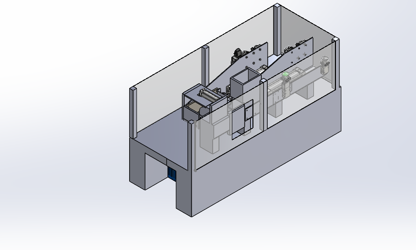
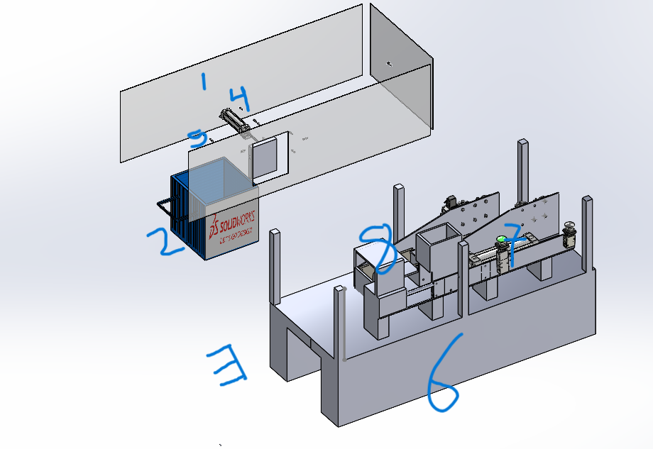
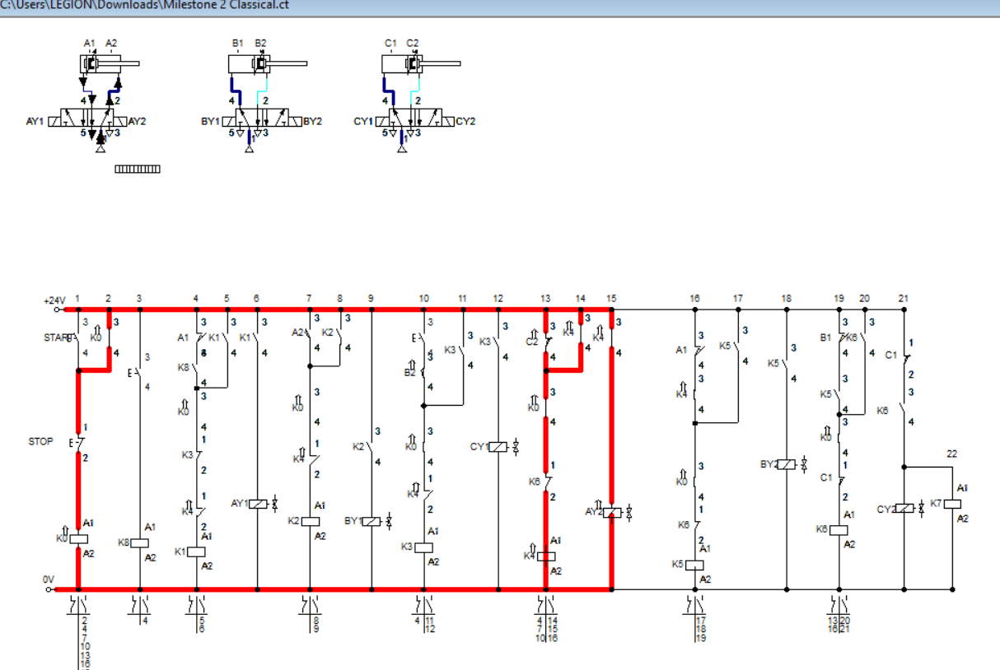
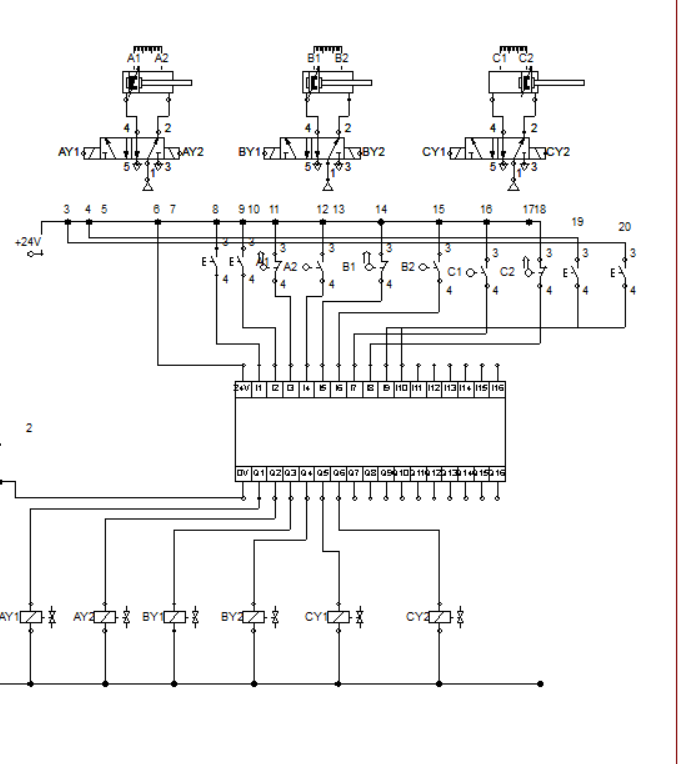
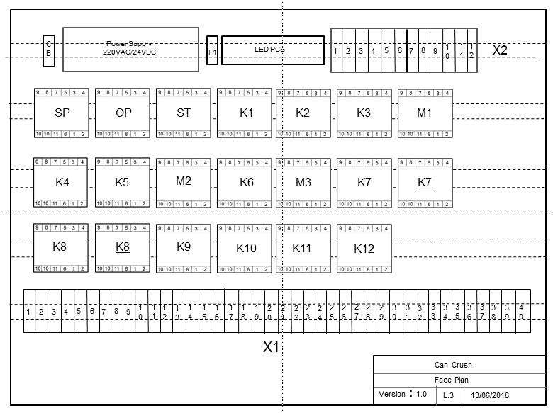

# Automated Can Crusher — Mechanical Design & Electropneumatic Control

**Individual academic project | Mechatronics Lab (MCTR704) | German International University, Berlin | 2025**

## Overview

This project documents the design of an automated can crusher, combining a **SolidWorks mechanical assembly**, **sequential pneumatic actuation**, **sensor-based control**, and **electrical control schematics**. The design includes a transparent enclosure and a removable collection container for crushed cans.

> **Project status:** The available evidence documents the design, circuit diagrams, and simulation screenshots. The original editable SolidWorks and FluidSIM project files are not currently included. Physical construction and hardware testing have not been verified by the available documentation.

## 1. Mechanical Design — SolidWorks



*Original SolidWorks assembly image extracted from the project report.*



*Exploded assembly view showing major mechanical sections.*

The proposed machine includes a supporting base and frame, transparent enclosure panels, can input magazine, crushing components, and a removable collection box. The design also considers manufacturing and assembly issues, including component accessibility, modular subassemblies, fastener standardization, and casting-related considerations.

## 2. Pneumatic Automation — Festo FluidSIM



*Original electropneumatic simulation screenshot from the project report.*

The design uses **three pneumatic cylinders**. Two provide linear motion, while one is coupled to a mechanism that converts linear displacement into rotation. The report specifies **seven capacitive proximity sensors**: six for cylinder end-position detection and one for can detection.

### Actuation sequence

`A+ → B+ → C+ → A− → B− → C−`

`+` indicates extension and `−` indicates retraction. The project report includes a pneumatic step diagram and electropneumatic circuit views.

## 3. Electrical Control & PLC-Related Design
### PLC Control Logic — Function Block Diagram

The project includes a graphical control logic design using digital inputs, logic gates, RS memory elements, and digital outputs.

The diagram documents the control logic associated with the automated can-crushing sequence.


*Function block control diagram showing input signals, logic operations, state memory, and output connections.*


*Electrical control schematic from the original report; this is **not** presented as a TIA Portal screenshot.*



*Electrical panel layout documented in the project report.*

The report contains electrical wiring and control documentation associated with the pneumatic sequence. **Siemens TIA Portal source files, PLC logic, and screenshots have not yet been recovered or independently verified.** They can be added to this section if the original project files are found.

## Engineering Topics

- 3D mechanical design and assembly using SolidWorks
- Pneumatic cylinders and sequential electropneumatic control
- Proximity sensing and end-position feedback
- Electrical control and wiring schematics
- Design for Manufacturing (DFM) and Design for Assembly (DFA)

## Repository Contents

```text
Automated-Can-Crusher-SolidWorks/
├── README.md
├── images/
│   ├── solidworks-assembly.png
│   ├── solidworks-exploded-view.png
│   ├── fluidsim-simulation.png
│   ├── electrical-control-schematic.png
│   └── electrical-panel-layout.jpg
└── [original project reports, if retained]
```

The `images/` files are extracted from the original academic report. This repository provides documentation and images, not the original editable CAD or simulation projects.

## Author

**Ahmed Waseim Azzam**  
B.Sc. Mechatronics Engineering — German International University  
M.Sc. Engineering Cybernetics — University of Stuttgart
